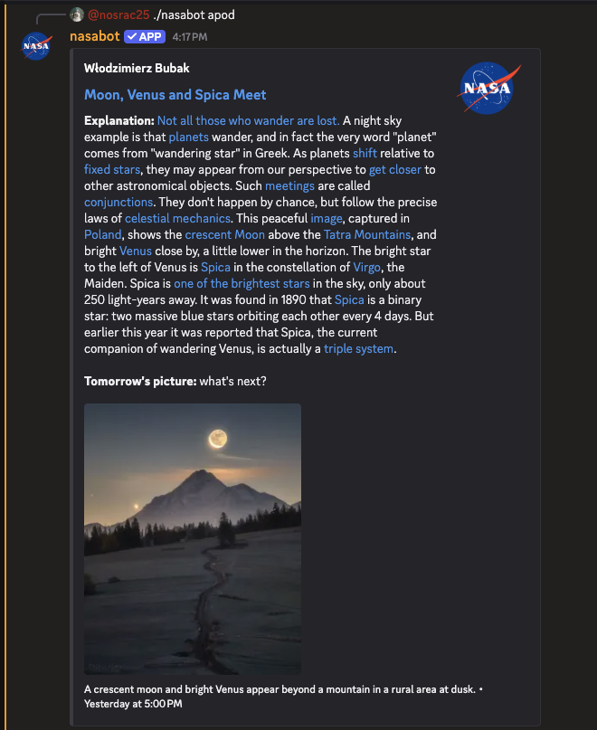

# nasabot

Discord bot to interact with https://api.nasa.gov!

## Example

```
> ./nasabot apod
```



## Getting started

### Building locally

```bash
$ npm install
$ npm run build
$ npm run bot
```

Will get you your own REPL.

#### Configuring runtime behavior with environment variables

Several environment variables control the runtime behavior; they are documented in [.assets/envvars.csv](envvars.csv).

> If you want to connect to your own discord server instead of using a REPL, run:

```bash
DISCORD_BOT_API_TOKEN=XXX npm run bot
```

> To keep track of what channels are subscribed to daily updates, you need to specify `AZURE_ACCOUNT`, `AZURE_ACCOUNT_KEY`, and `AZURE_TABLE_NAME`.

> To increase your rate limit on api.nasa.gov, ensure you have `NASA_API_TOKEN` in your enviornment.

### Add nasabot to your server

If you don't want to host your own instance, feel free to use mine!
[link](https://discord.com/oauth2/authorize?client_id=701258422498099200)
